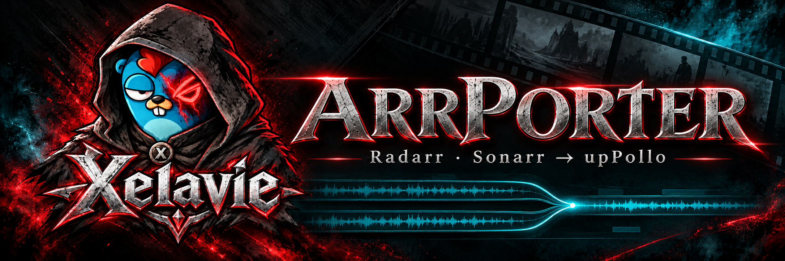

# ArrPorter

**Originalname bleibt. Release kommt an.** Radarr und Sonarr können Videos beim Import umbenennen. ArrPorter legt im Transit einen Hardlink mit dem ursprünglichen Dateinamen an und übergibt das Release an upPollo. Die Importskripte brauchen kein Docker; Bibliothek und Transit müssen Hardlinks auf demselben Dateisystem erlauben.

| Eingang | Was ArrPorter macht |
|---|---|
| Filmimport oder Upgrade | Aktuelle Extras übernehmen, Release prüfen und einen Auftrag übergeben. Untertitel inklusive IDX/SUB liegen im Transit unter `Subs/`; SFV wird nicht übernommen. |
| Einzelne Folge | Ursprünglichen Namen über die Sonarr-Historie rekonstruieren. Für bestimmte Gruppen kann genau eine MKV ohne Extras direkt übergeben werden. |
| Staffelpack | Einzelmeldungen sammeln, Vollständigkeit prüfen und das Pack einmal übergeben. Echte Episoden-Unterordner bleiben erhalten; eine doppelte identische äußere Ordnerebene wird normalisiert. |
| Optionaler Cleanup für Unraid | Prüft Tageslogs, Jobstatus und qBittorrent vor der Bereinigung. Bei unklarem Ergebnis bleibt der Transit erhalten. Das mitgelieferte Hostskript ruft die Prüfungen per `docker exec` in den Arr-Containern auf. |

**[Gemeinsame Konfiguration und Migration](docs/ANLEITUNG.md)** · [Radarr einrichten](docs/RADARR.md) · [Sonarr einrichten](docs/SONARR.md) · [Konfigurationsvorlage](arrporter.conf.example)

## srrDB-Prüfung vor dem Upload

Radarr und Sonarr fragen beim Import den exakten Release-Namen bei srrDB ab. Gibt es einen Eintrag, vergleicht ArrPorter die geplanten Originalnamen und Unterordner einschließlich Groß-/Kleinschreibung. Für jedes Video, jede NFO und jeden unterstützten Untertitel liest ArrPorter die Datei vollständig und vergleicht ihre CRC32 mit der Referenz. Das gilt auch im Probelauf.

| Meldung im Joblog | Was beim Import passiert |
|---|---|
| `srrDB OK` | Namen, Pfade und Prüfsummen stimmen. Der Import-Hook fährt fort. |
| `Original-NFO geladen und geprüft` | Eine vorhandene NFO hat unter dem erwarteten Namen eine andere CRC32. ArrPorter lädt die Original-NFO dieses Releases von srrDB und verwendet sie nach erfolgreicher CRC32-Prüfung. |
| `fehlt`, `unerwarteter Name/Pfad` oder `CRC32 weicht ab` | ArrPorter stoppt vor der Übergabe an upPollo. Das Log nennt die betroffene Datei und bei einem CRC32-Fehler beide Prüfwerte. |
| `Kein Eintrag` | Das Release wird mit den lokalen Prüfungen weiterverarbeitet. Das gilt auch für P2P-Releases ohne srrDB-Eintrag. |

Ist srrDB nicht erreichbar oder fehlt eine benötigte Referenz-Prüfsumme in einem bekannten Release, stoppt die Übergabe ebenfalls. [Details zum srrDB-Abgleich](docs/ANLEITUNG.md#srrdb-abgleich-vor-der-übergabe)

## Konfiguration und Probelauf

Adressen und Zugangsdaten stehen einmal in der privaten `arrporter.conf`. Jeder Dienst hat seine eigene `filters.conf`, seinen Transitpfad und seinen eigenen Schalter für den Probelauf.

Beide Dienste starten in der Vorlage im Probelauf. ArrPorter prüft Radarr-Extras in einem temporären Verzeichnis. Sonarr sichert Extras für das spätere Sammelereignis. Der reguläre Bibliotheksimport durch Radarr oder Sonarr findet in beiden Fällen statt.

ArrPorter ist eigenständig. Die Installation von upPollo, Tracker, Indexer und Download-Clients gehört nicht zum Paket.
